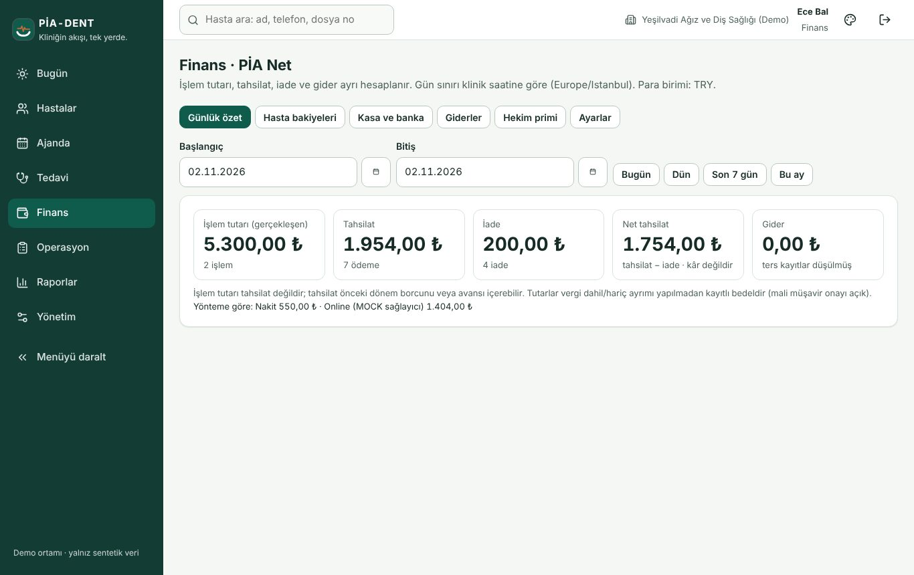
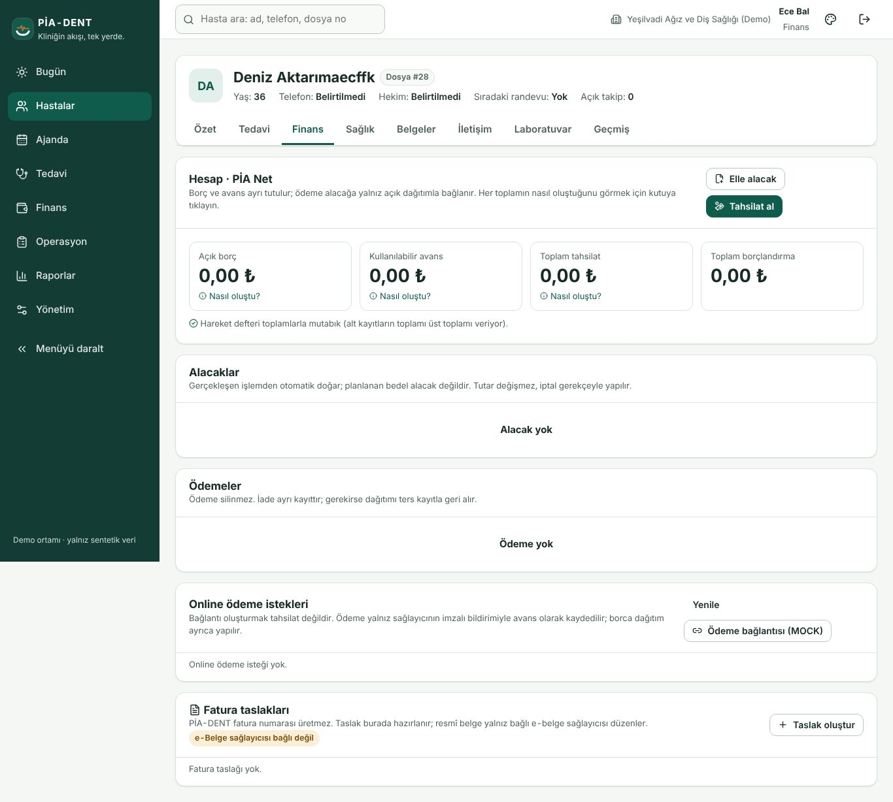
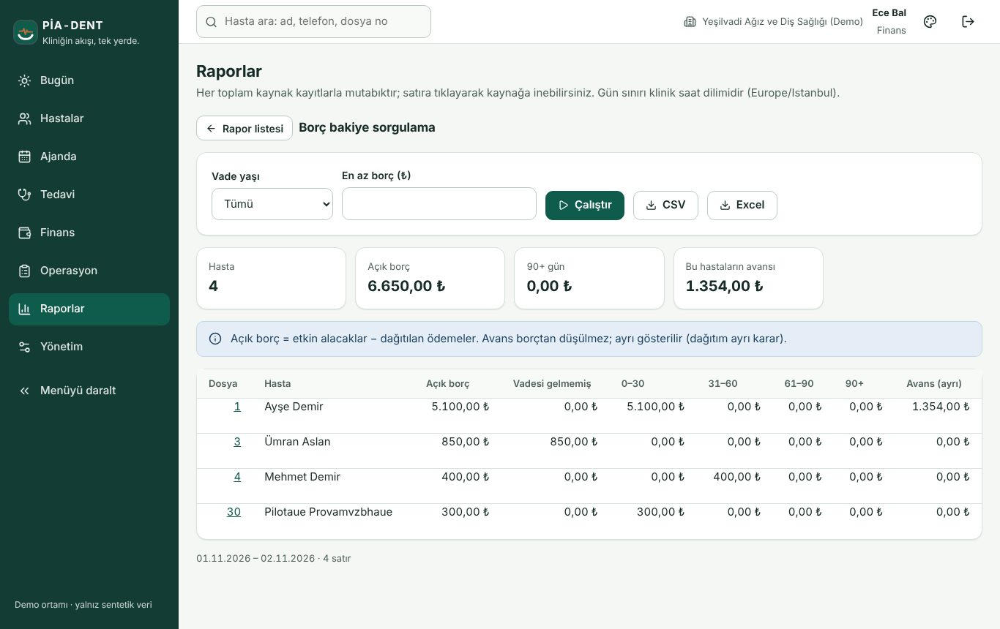
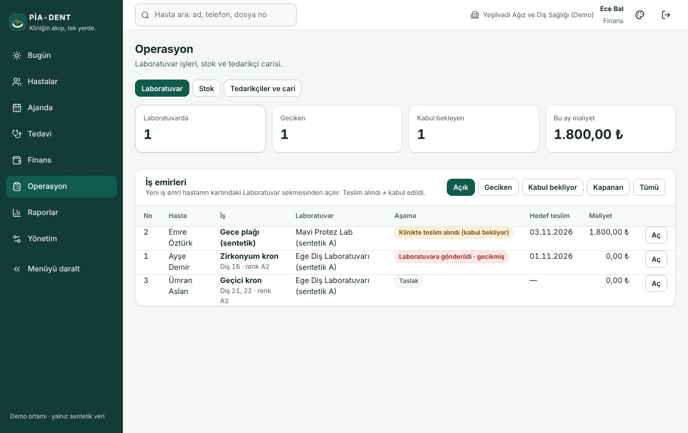

# Finans — kasa ve gün sonu (1 sayfa)

**Finans → PİA Net.** Günlük özet (işlem tutarı ≠ tahsilat), hasta bakiyeleri, kasa ve banka, giderler, hekim primi, ayarlar. Her tutar kayıtlı tutardır; KDV gösterimi mali müşavir onayı bekler (ekranda yazılı).

**Hasta hesabı.** Alacaklar, ödemeler, dağıtım, avans, iade. Silme yoktur: hata ters kayıt/iade ile düzeltilir ve gerekçe ister. Açılış bakiyeleri "açılış bakiyesi" kaynağıyla tek satırdır.

**Gün sonu.** Raporlar → Nakit hareketleri / Kasa; toplam = alt satırlar; CSV ile eski sistemle paralel karşılaştırma (pilotta 2 hafta).

**Borç bakiye raporu.** Yaşlandırma (0–30 / 31–60 / 61–90 / 90+), avans ayrı; satırdan hastanın hesabına inilir.

**Operasyon.** Tedarikçi carisi (fatura/ödeme/ters kayıt), stok (lot/SKT), laboratuvar maliyeti.

**Güvenlik.** Finans rolünde iki adımlı doğrulama zorunlu olabilir: Hesabım → kurulum; 8 kurtarma kodunu saklayın.
