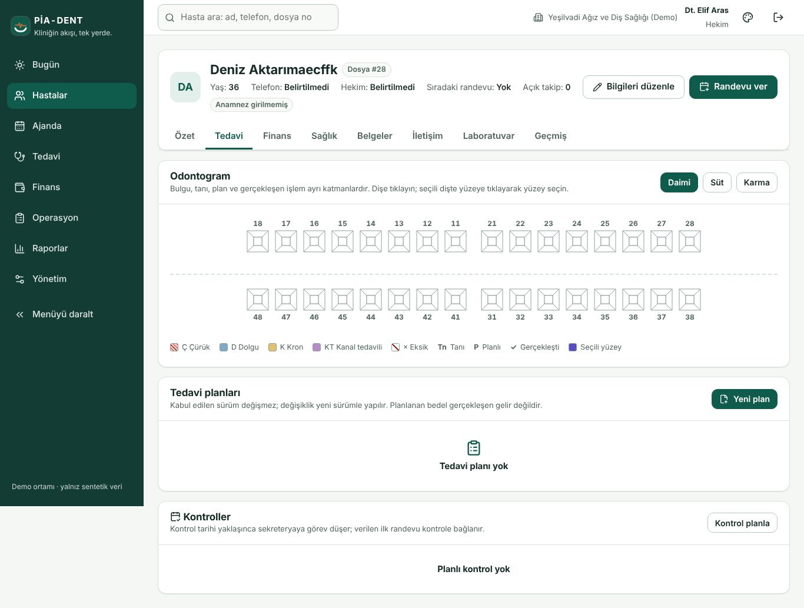
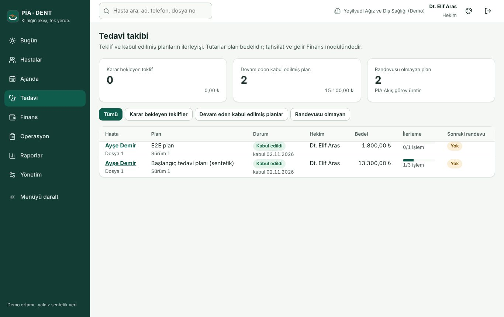

# Hekim — klinik akış (1 sayfa)

**Hasta 360 → Tedavi.** FDI odontogram: dişe tıklayıp bulgu/tanı; "Yeni plan" ile tedavi planı → kalem ekle → Teklif sun → kabul sonrası sürüm kilitlenir (değişiklik yeni sürüm açar). Gerçekleşen işlem ziyarete bağlanır ve alacağı otomatik üretir (snapshot bedel). Önceki sistemden aktarılan işlemler "aktarıldı · alacak yok" notuyla listelenir.

**Klinik notlar ve anamnez.** Sürümlü anamnez (eski sürüm salt okunur, kritik uyarılar kartta); klinik not yalnız sağlık yetkili rollere görünür; dosya (röntgen/fotoğraf) taranmadan indirilemez.

**Tedavi panosu.** Bekleyen plan kararları, bugünkü seanslar, laboratuvar işleri (gönder → teslim → kabul/revizyon; iş föyü yazdırılır).

**Raporlar.** Tedavi raporlarında yalnız kendi işlemleriniz görünür. Prim dökümü finans/yöneticide.

**Dikkat:** işlem iptali bağlı alacağı iptal eder ve tahsilat avansa döner — denetimde görünür. Tanı kodu serbest metindir (kod sistemi pilot kararı).

**Anamnez formu ve klinik çıktılar (02.11.2026).** Kliniğin anamnez formunu yönetici/hekim taslak olarak hazırlar, **yalnız hekim yayınlar** (Yönetim → Anamnez şablonu). Eski kayıtlar alındıkları formla gösterilir. Belgeler → Belge hazırla → **Epikriz / Hasta bilgi föyü / Reçete yazısı**: tanılar, gerçekleşen işlemler ve anamnez kritik işaretleri kayıttan yazılır; serbest metne öneri/ilaç listesi girersiniz. Bu belgeler sağlık verisidir, sekreter göremez. Reçete yazısı **e-reçete değildir**.
