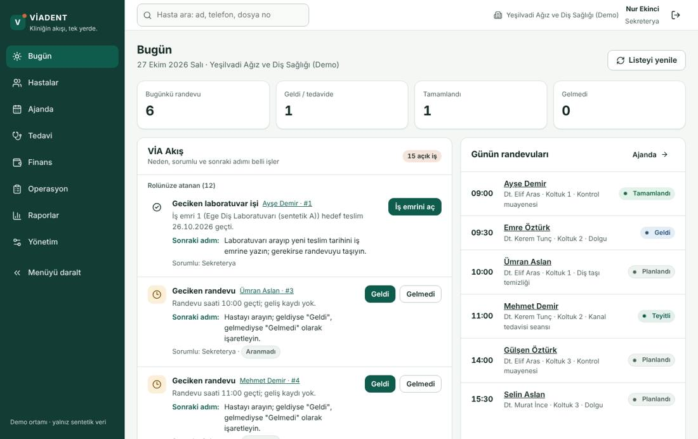
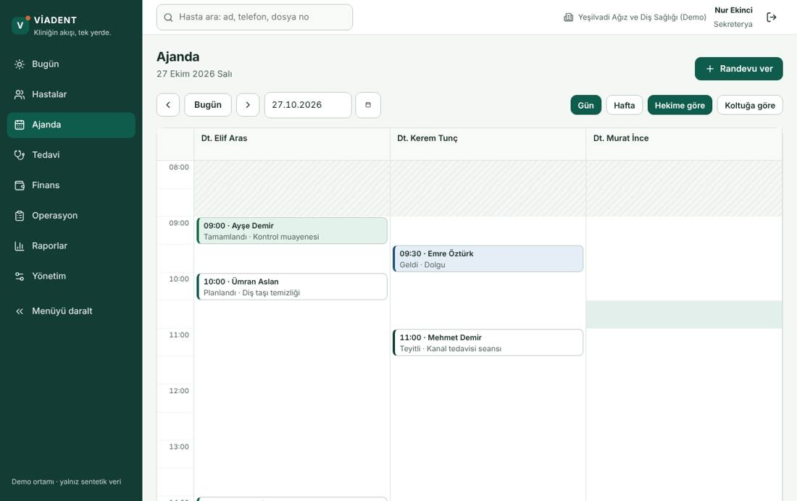
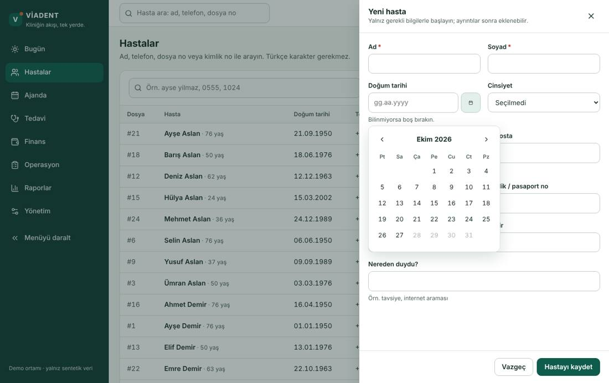
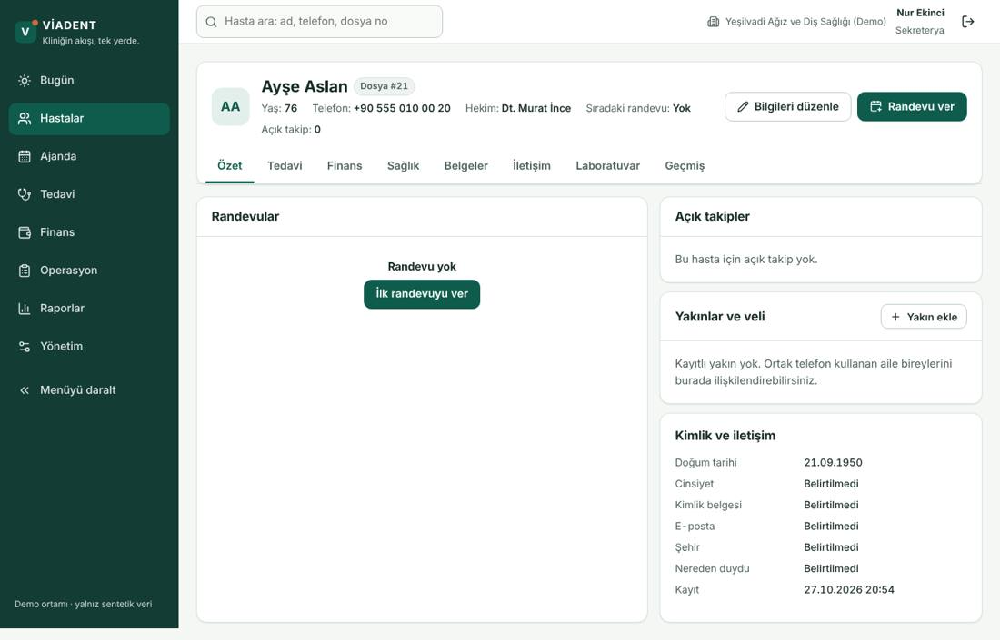

# Sekreter — günlük akış (1 sayfa)

**Sabah: Bugün ekranı.** Günün randevuları ve VİA Akış görevleri (neden, sorumlu, sonraki adım). "Geciken randevu" görevi randevu saati eşik kadar geçince düşer; **Geldi / Gelmedi** ile kapatın.

**Ajanda.** Gün/hafta, hekime ya da koltuğa göre. Boş alana tıklayıp randevu verin; çakışma ve çalışma saati dışı uyarıları sunucudan gelir (bilinçli onayla geçilebilir, ikinci bir randevu aynı saate verilemez).

**Hasta kaydı.** Hastalar → Yeni hasta. Ad, soyad; doğum tarihi gg.aa.yyyy yazarak ya da takvimden. Aynı ad + doğum tarihi varsa **mükerrer aday** uyarısı çıkar; gerçekten farklı kişiyse "Farklı kişi, yine de kaydet". Kimlik no her zaman maskeli görünür; tam değer için "Göster" (gerekçe ister, denetime yazılır).

**Hasta 360.** Özet, randevu geçmişi (önceki sistemden aktarılanlar dahil), iletişim tercihi, belgeler. Yarınki randevu teyidi görevi: hastayı arayın, iletişim sonucunu kaydedin (**gerçek SMS gitmez**; MOCK etiketi).

**Tahsilat.** Hasta 360 → Finans → Tahsilat al: tutar, yöntem; "Vadesi eski olandan başlayarak dağıt". Çift tıklama tek kayıt oluşturur. İade yapamazsınız (finans rolü).

**Dikkat:** iptal yerine "Gelmedi" seçmeyin; iptal gerekçe ister ve kapasiteyi boşaltır. Kapatma (tatil) randevuyu silmez, görev düşer, siz karar verirsiniz.
