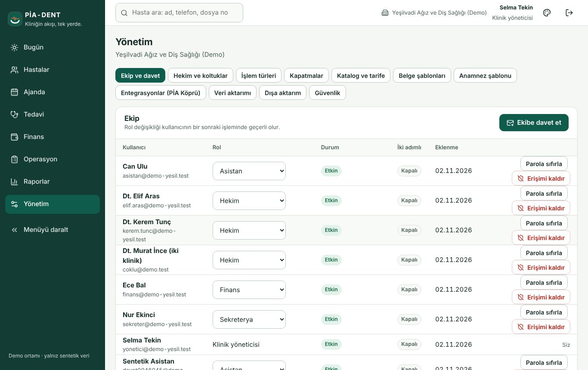
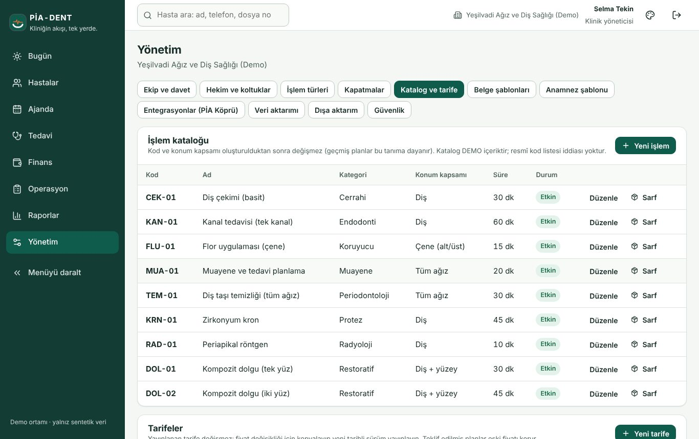
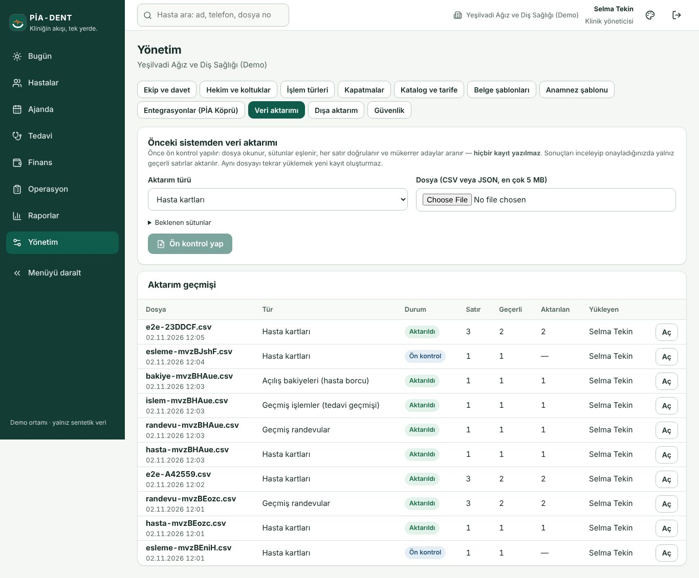
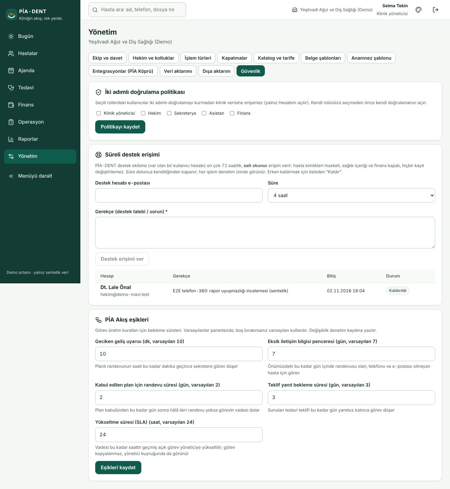
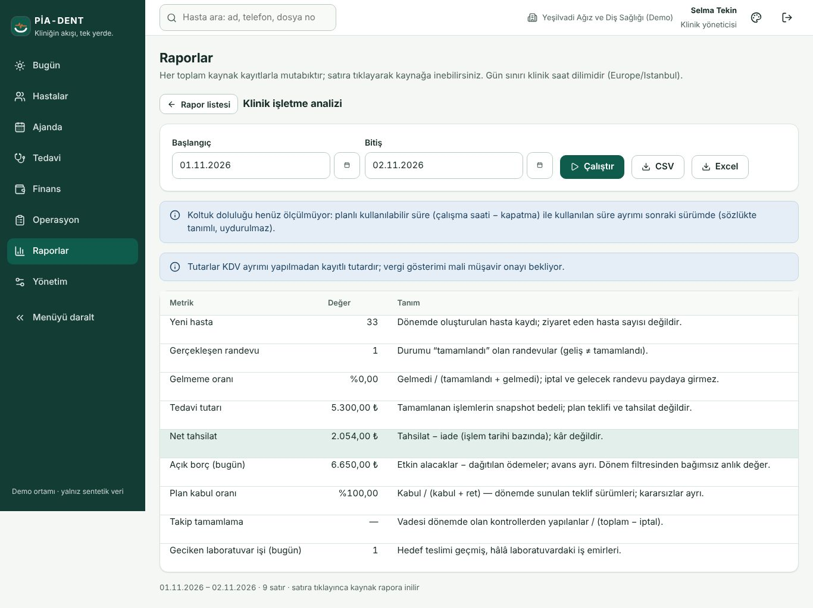
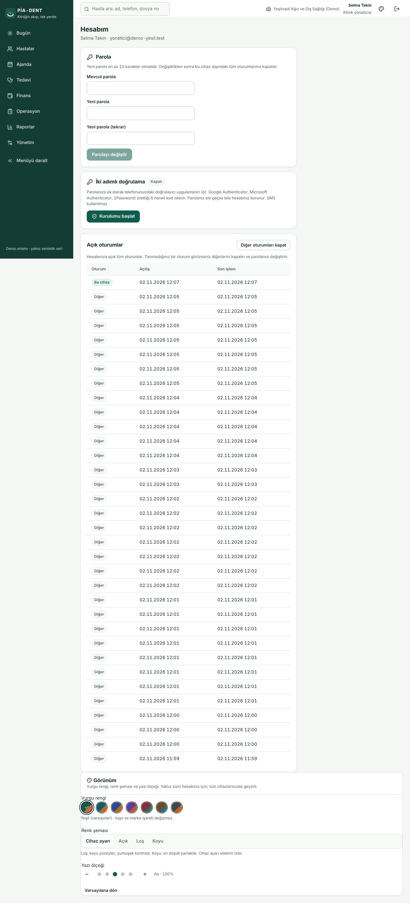

# Klinik yöneticisi — kurulum ve yönetim (1 sayfa)

**Ekip ve davet.** Kullanıcıları rolle davet edin; erişim kaldırınca anında düşer. Parola sıfırlama geçici parola verir (bir kez görünür), doğrulayıcı sıfırlama gerekçe ister.

**Hekim ve koltuklar / İşlem türleri / Kapatmalar / Katalog ve tarife.** Tarife sürümlüdür; eski planlar eski fiyatla kalır.

**Veri aktarımı.** Sıra: hasta kartları → geçmiş randevular → geçmiş işlemler → açılış bakiyeleri. Dosyayı seçin, **Sütun eşlemesi**'nde tanınmayan başlıkları elle eşleyin, Ön kontrol (hiçbir şey yazılmaz) → hatalı satırları CSV indirip düzeltin → "N satırı aktar" → gerekirse gerekçeyle geri al. Aynı dosya tekrar yeni kayıt açmaz.

**Güvenlik.** MFA zorunlu roller; süreli destek erişimi (ikinci yönetici onaylar); **PİA Akış eşikleri** (geciken geliş dk, eksik iletişim penceresi, plan randevu süresi, teklif yanıt süresi).

**Entegrasyonlar (PİA Köprü).** SMS ve online ödeme yalnız MOCK; gerçek sağlayıcı sözleşmesi olmadan hiçbir mesaj gitmez, para hareket etmez. Dört göz onayı gereken işler burada bekler.

**Raporlar.** Klinik işletme analizi → metrikten kaynak rapora iniş; CSV yalnız yönetici/finans.

**Hesabım.** İki adımlı doğrulama, kurtarma kodları, açık oturumlar ("diğerlerini kapat"), parola.

**02.11.2026 eklemeleri.** *Anamnez şablonu* (Yönetim): taslak hazırlayın, hekim yayınlasın; yayındaki form değişmez, yeni sürüm açılır. *Sarf reçetesi* (Katalog → işlem satırı → Sarf): işlem tamamlanınca düşülecek stok kalemleri; stok yetersizse işlem yine kaydedilir, asistana "sarf düşülemedi" görevi düşer. *PİA Akış yükseltme* (Güvenlik → PİA Akış eşikleri → Yükseltme süresi): vadesi bu kadar saat geçmiş görev size "Yükseltildi" rozetiyle gelir; asıl sorumlunun görevi de kalır. *e-Belge MOCK bağlantısı* (PİA Köprü): fatura akışını göstermek içindir; gerçek belge düzenlenmez.
